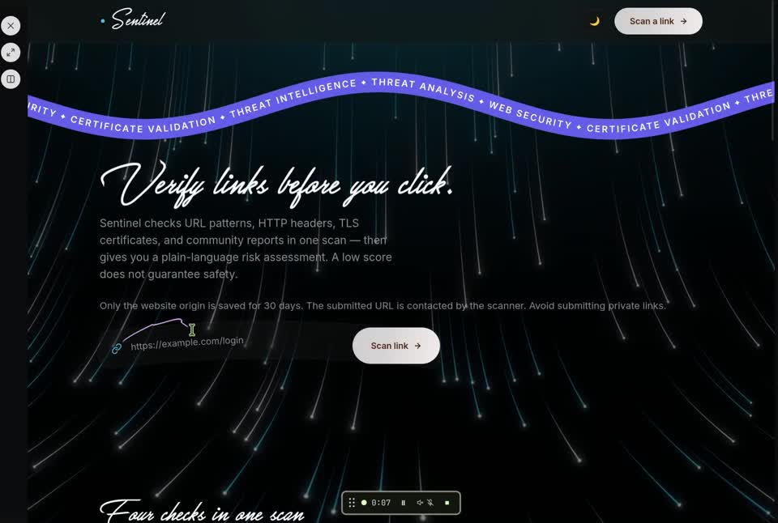

# Sentinel

**Where does this link go, and what can you trust about it?** Paste a URL to follow its redirects, inspect the site's security headers, and check its HTTPS certificate.

**[Open the live scanner →](https://sentinel-iota-snowy.vercel.app)** · [Scoring and limits](docs/security-audit.md) · [Deployment guide](docs/vercel-deployment.md)

[](https://youtu.be/Rdr5mtgV3o8)

**[Watch the demo on YouTube](https://youtu.be/Rdr5mtgV3o8)** — Follow a link from submission to its risk score and individual checks.

## Inside a scan

| Signal | What Sentinel checks |
| --- | --- |
| Address | URL patterns associated with deception, including IP-based hosts and account-related keywords. |
| HTTP response | Redirect destinations and browser protections advertised by the server. |
| HTTPS certificate | TLS validation, issuer, and expiry. |
| Community reports | Unverified reports for the host, displayed separately from its score. |

The **0–100 risk score** summarizes observed signals. A phishing page can have a valid certificate and a low score. An incomplete check can yield **Inconclusive**. Sentinel does not inspect downloads for malware.

## What gets stored

The scanner contacts the submitted URL. Scan history keeps the origin (for example, `https://example.com`) and drops the path, query string, and fragment. Records have a 30-day retention window and a 10,000-row cap per table.

## Run locally

From the repository root with Node.js 24:

```sh
npm ci
npm run build
npm start
```

Open **http://localhost:3000**. React and Vite build the interface into `public/`. Express serves the interface and API together. Local scans use SQLite. The Vercel deployment stores results in hosted libSQL.

Run `npm test` for detector, storage, startup, security, and capacity checks. Open `/api/health` to check the running service and its database connection.

## License

Original Sentinel code is available under the [MIT License](LICENSE). Third-party code, fonts, and artwork retain their own terms. [Great Day](great-day-font.zip) is licensed for personal use. [Rubiks Cube](rubiks-cube-font.zip) requires the designer’s permission for public media use and sharing.
